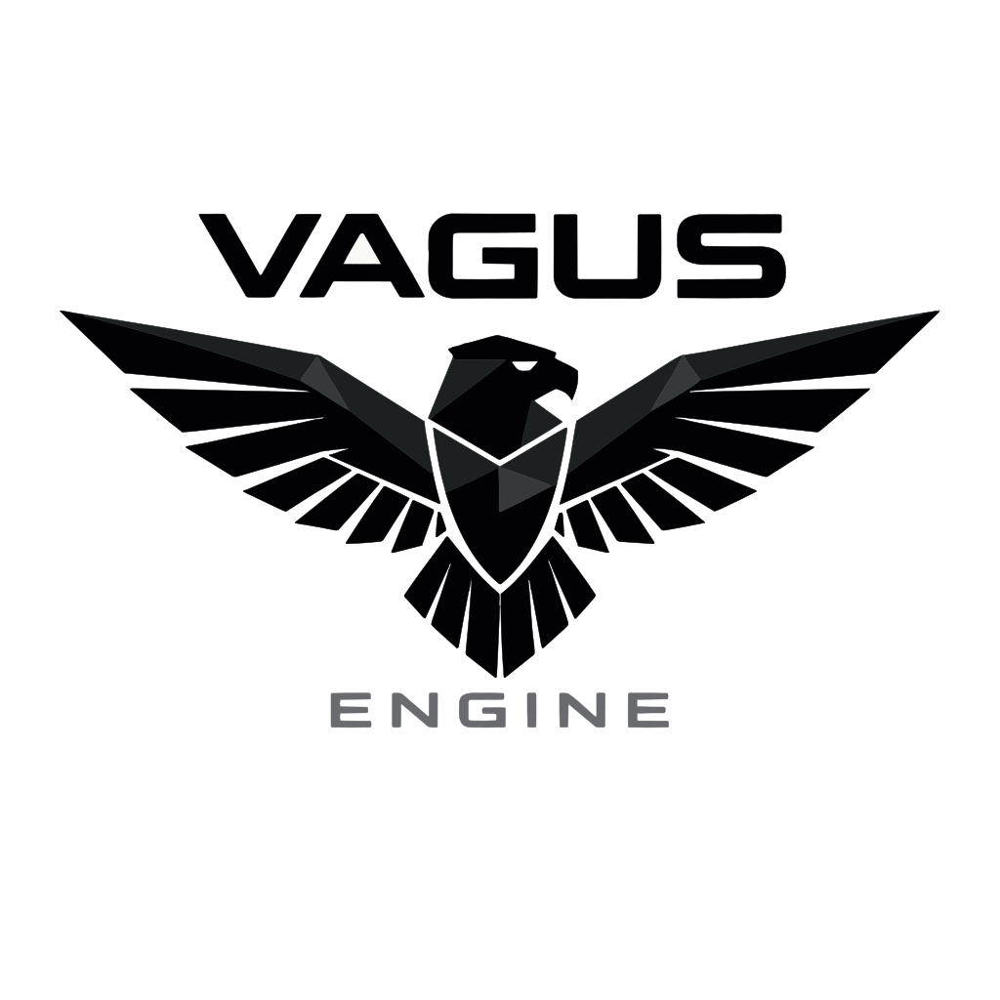

# Vagus Engine

<p align="center">
  
</p>

<p align="center"><strong>A modular Rust game-engine workspace for building worlds, simulations, and interactive graphics.</strong></p>

Vagus Engine brings its public engine API together with native backends and low-level Rust utilities. The project is under active development, so APIs and backend support are evolving.

## What’s inside

| Area | Public API |
| --- | --- |
| Windows and input | Window configuration, input events, and event-state helpers |
| World and simulation | 2D/3D math, hitboxes, physics objects, and ECS storage |
| Rendering | Renderer, textures, shaders, and ray-tracing interfaces |
| Audio | Audio output configuration, streaming writes, and draining |
| World generation | Heightmaps, material composition, seeded value noise, and fBm |

These describe the API areas available in the workspace; backend and hardware support can vary by platform and feature.

## Workspace crates

| Crate | Role |
| --- | --- |
| `vagus` | Main library and public engine API. |
| `nucleus` | Native platform, audio, and graphics backend implementation. |
| `vagus_essential` | Foundational allocator, collections, async, and window utilities. |
| `soa_derive` | Procedural derive macro supporting structure-of-arrays data. |

The `vagus` crate re-exports its API modules, including `audio`, `ecs`, `event`, `heightmap`, `material`, `math`, `physics`, `proc_gen`, `render`, `rtx`, `scene`, `shader`, `texture`, and `window`.

## Build and test

You’ll need a Rust toolchain and Cargo with support for Rust edition 2024. From the repository root:

```sh
cargo build -p vagus
cargo test -p vagus
```

The integration tests are in `tests/` and exercise the public APIs as well as core utilities.

## Project status

Vagus Engine is actively being built. Expect interfaces to change, and check the relevant API and platform backend before relying on a feature in a production application.

## License
Apache 2.0